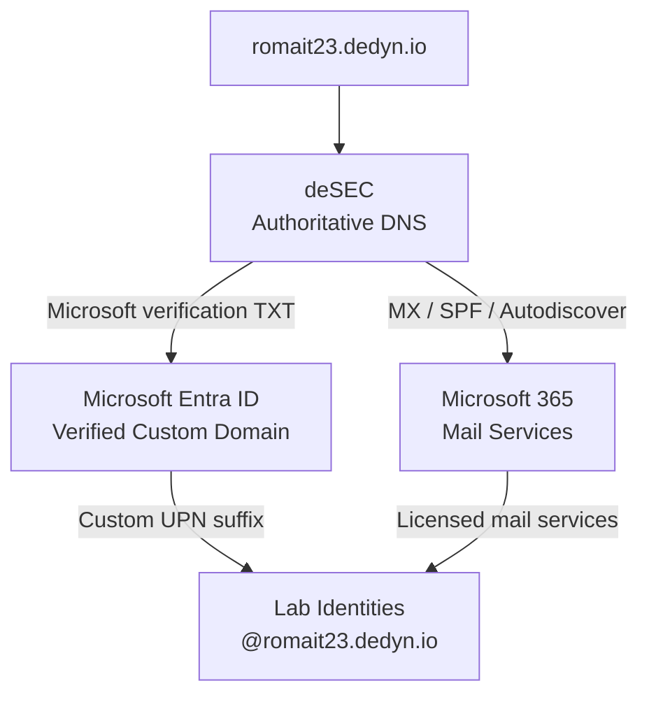
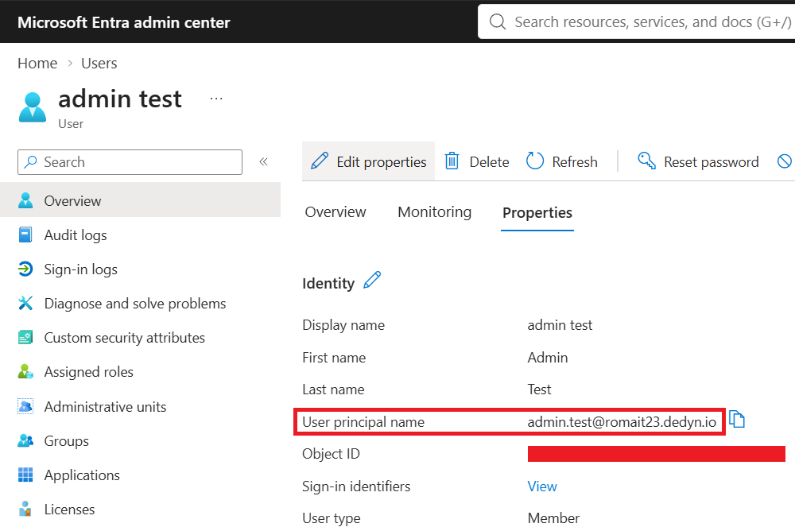
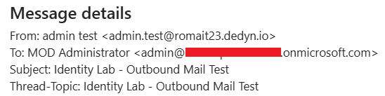
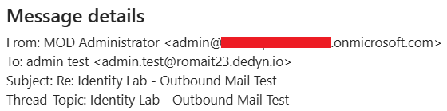

# Custom Domain Integration

## Objective

Integrate a custom domain with the existing Microsoft Demo Experiences environment and use it across Microsoft Entra ID and Microsoft 365.

The domain used for the lab is:

`romait23.dedyn.io`

The objective was to go beyond the default domain supplied with the demo tenant and gain hands-on experience with domain verification, external DNS management, cloud identity naming, and Microsoft 365 messaging integration.

## Environment

- Microsoft Entra ID
- Microsoft 365
- Exchange Online
- deSEC DNS
- Microsoft Demo Experiences tenant

## Integration Architecture

The custom-domain configuration connected externally managed DNS with Microsoft Entra ID and Microsoft 365 services.

The arrows represent configuration and service relationships rather than network traffic flows.

## Configuration

### 1. Custom Domain Registration

I added `romait23.dedyn.io` as a custom domain to the existing Microsoft Entra ID tenant.

The objective was to use a domain under my control rather than relying exclusively on the default domain supplied with the Microsoft Demo Experiences environment.

The domain was managed externally through deSEC, allowing the DNS records required for Microsoft domain verification and Microsoft 365 services to be configured directly.

### 2. Domain Verification

After configuring the required DNS records, the custom domain was successfully verified in Microsoft Entra ID.

The tenant currently shows `romait23.dedyn.io` with a **Verified** status.

An earlier experiment using `romait23.duckdns.org` is also visible. I initially explored DuckDNS before moving to deSEC for the DNS configuration used in the later Microsoft 365 and Exchange Online integration.

### 3. DNS Configuration

Public DNS for `romait23.dedyn.io` is hosted and managed through deSEC.

The DNS zone was configured with the records required for Microsoft 365 domain verification and Exchange Online mail services.

Key records included:

| Record | Purpose |
| --- | --- |
| CNAME `autodiscover` | Directs Outlook clients to the Exchange Online Autodiscover service |
| MX | Routes inbound mail for the domain to Exchange Online Protection |
| TXT / SPF | Authorizes Microsoft 365 infrastructure to send mail for the domain |
| TXT / Microsoft verification | Used to verify ownership of the domain with Microsoft |
| NS | Delegates authoritative DNS hosting to deSEC |

The configuration connects an externally managed DNS zone with Microsoft Entra ID, Microsoft 365, and Exchange Online services.

### 4. Microsoft 365 Mail Integration

The custom domain was also configured for use with Microsoft 365 mail services.

Users with the appropriate Microsoft 365 licensing could use mailboxes associated with the custom domain. Public DNS was configured to support Microsoft 365 mail routing and client discovery through:

- MX records for Exchange Online Protection
- SPF authorization for Microsoft 365 mail infrastructure
- Autodiscover for Outlook and Exchange Online service discovery

The lab also explored the relationship between a user's Microsoft Entra ID User Principal Name (UPN) and the primary SMTP address associated with the mailbox.

No separate Exchange Online mail-flow or transport configuration is documented as part of this experiment.

### 5. User Principal Name Configuration

After the custom domain was verified, I configured a lab identity to use `romait23.dedyn.io` as its User Principal Name (UPN) suffix.

This allowed the test identity to sign in using an identity associated with the custom domain rather than the default domain supplied with the Microsoft Demo Experiences tenant.

The test account was configured with the UPN:

`admin.test@romait23.dedyn.io`

This exercise also helped demonstrate the distinction between an identity's Microsoft Entra ID UPN and the email addresses associated with Microsoft 365 mail services. Although these values can be aligned, they represent different identity and messaging attributes.

## Validation

The custom-domain implementation was validated at multiple layers.

| Test | Result |
| --- | --- |
| Custom domain registered in Microsoft Entra ID | Passed |
| Domain ownership verification | Passed |
| Microsoft 365 DNS records configured | Passed |
| Custom UPN assigned to lab identity | Passed |
| Outbound mail using the custom domain | Passed |
| Inbound mail using the custom domain | Passed |

### Mail Flow Validation

To confirm that the custom domain was functional beyond the Microsoft Entra identity namespace, I tested bidirectional mail flow using the lab identity:

`admin.test@romait23.dedyn.io`

#### Outbound Mail

A message sent from `admin.test@romait23.dedyn.io` was successfully delivered to another mailbox.

#### Inbound Mail

A reply addressed to `admin.test@romait23.dedyn.io` was successfully received by the lab mailbox.

Together, these tests confirmed that the custom domain was successfully integrated with both the Microsoft Entra identity namespace and the Microsoft 365 mail services used by the lab.

## Troubleshooting and Observations

### Initial DuckDNS Experiment

Before implementing the final configuration using deSEC, I experimented with `romait23.duckdns.org` as the custom domain for the lab.

The DuckDNS domain could be added and successfully verified in Microsoft Entra ID, and it remains visible in the tenant as a verified custom domain.

However, verification in Entra ID was only part of the objective. I also wanted the custom domain to support the Microsoft 365 mail-related configuration used by the lab identities.

During this stage, I found that the DuckDNS setup did not provide the DNS configuration flexibility I needed for the required Outlook and Microsoft 365 mail-related records. Although I could use the domain for the Entra identity namespace, I could not complete the intended mail configuration for users using that domain.

I therefore moved the lab domain to `romait23.dedyn.io` and used deSEC for authoritative DNS management.

With deSEC, I was able to configure the required records, including:

- Microsoft domain verification
- MX
- SPF
- Autodiscover

This allowed the same custom domain to be used across the identity and Microsoft 365 portions of the lab.

## Lessons Learned

The earlier DuckDNS experiment also highlighted an important distinction between domain verification and full service integration.

Successfully verifying a domain in Microsoft Entra ID proves ownership and allows the domain to participate in the identity namespace, but that does not by itself mean the DNS environment is suitable for every Microsoft 365 workload.

Moving to deSEC provided the DNS control required to support both the Entra identity configuration and the additional records needed for Microsoft 365 mail services.
