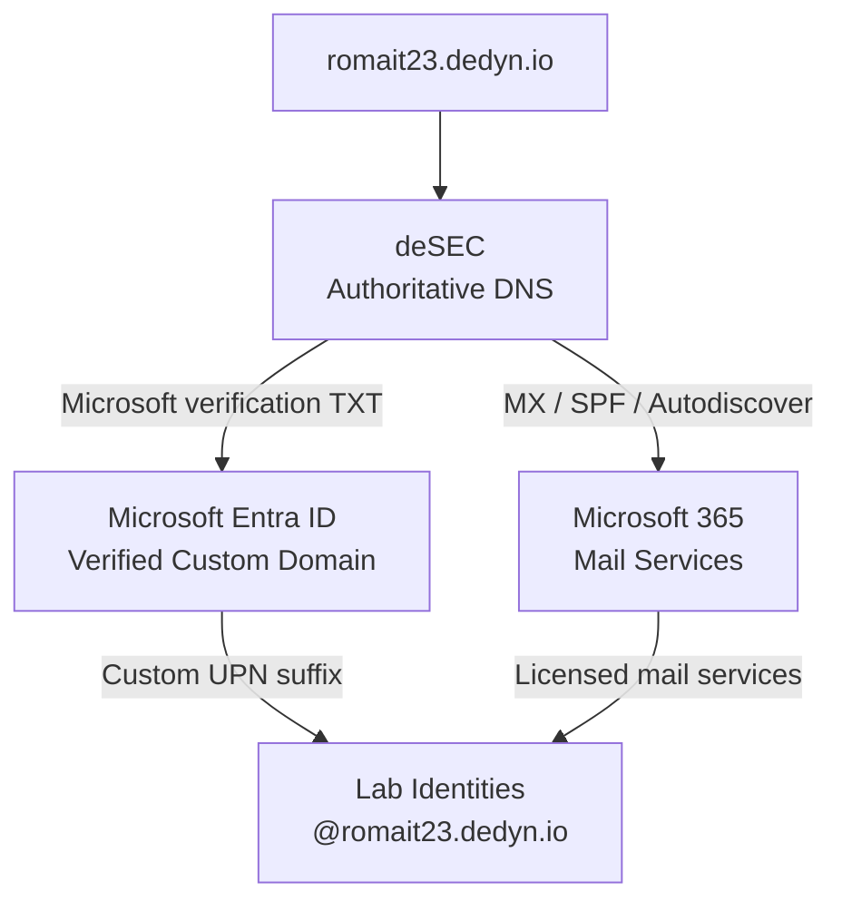
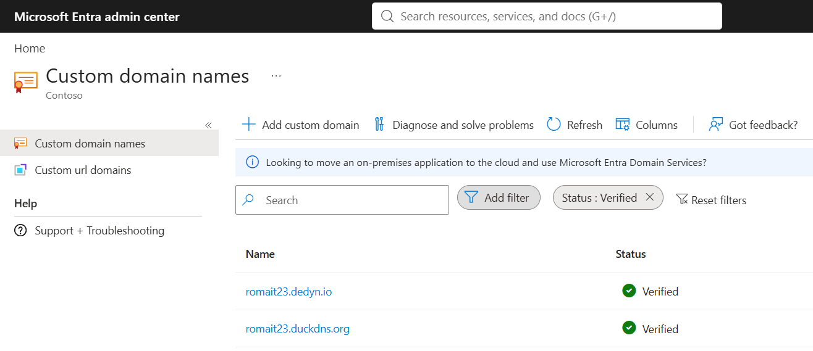
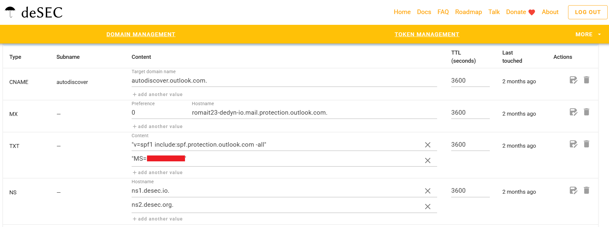

# Custom Domain Integration

## Objective

Integrate a custom domain with the existing Microsoft Demo Experiences environment and use it across Microsoft Entra ID and Microsoft 365.

The domain used for the lab is:

`romait23.dedyn.io`

The objective was to go beyond the default domain supplied with the demo tenant and gain hands-on experience with domain verification, external DNS management, cloud identity naming, and Microsoft 365 messaging integration.

## Environment

- Microsoft Entra ID
- Microsoft 365
- Exchange Online
- deSEC DNS
- Microsoft Demo Experiences tenant

## Integration Architecture

The custom-domain configuration connected externally managed DNS with Microsoft Entra ID and Microsoft 365 services.

The arrows represent configuration and service relationships rather than network traffic flows.

## Configuration

### 1. Custom Domain Registration

_To be documented and validated._

### 2. Domain Verification

After configuring the required DNS records, the custom domain was successfully verified in Microsoft Entra ID.

The tenant currently shows `romait23.dedyn.io` with a **Verified** status.

An earlier experiment using `romait23.duckdns.org` is also visible. I initially explored DuckDNS before moving to deSEC for the DNS configuration used in the later Microsoft 365 and Exchange Online integration.

### 3. DNS Configuration

Public DNS for `romait23.dedyn.io` is hosted and managed through deSEC.

The DNS zone was configured with the records required for Microsoft 365 domain verification and Exchange Online mail services.

Key records included:

| Record | Purpose |
| --- | --- |
| CNAME `autodiscover` | Directs Outlook clients to the Exchange Online Autodiscover service |
| MX | Routes inbound mail for the domain to Exchange Online Protection |
| TXT / SPF | Authorizes Microsoft 365 infrastructure to send mail for the domain |
| TXT / Microsoft verification | Used to verify ownership of the domain with Microsoft |
| NS | Delegates authoritative DNS hosting to deSEC |

The configuration connects an externally managed DNS zone with Microsoft Entra ID, Microsoft 365, and Exchange Online services.

### 4. Microsoft 365 Mail Integration

The custom domain was also configured for use with Microsoft 365 mail services.

Users with the appropriate Microsoft 365 licensing could use mailboxes associated with the custom domain. Public DNS was configured to support Microsoft 365 mail routing and client discovery through:

- MX records for Exchange Online Protection
- SPF authorization for Microsoft 365 mail infrastructure
- Autodiscover for Outlook and Exchange Online service discovery

The lab also explored the relationship between a user's Microsoft Entra ID User Principal Name (UPN) and the primary SMTP address associated with the mailbox.

No separate Exchange Online mail-flow or transport configuration is documented as part of this experiment.

### 5. User Principal Name Configuration

_To be documented and validated._

## Validation

_To be documented._

## Troubleshooting and Observations

_To be documented._

## Lessons Learned

_To be documented._
