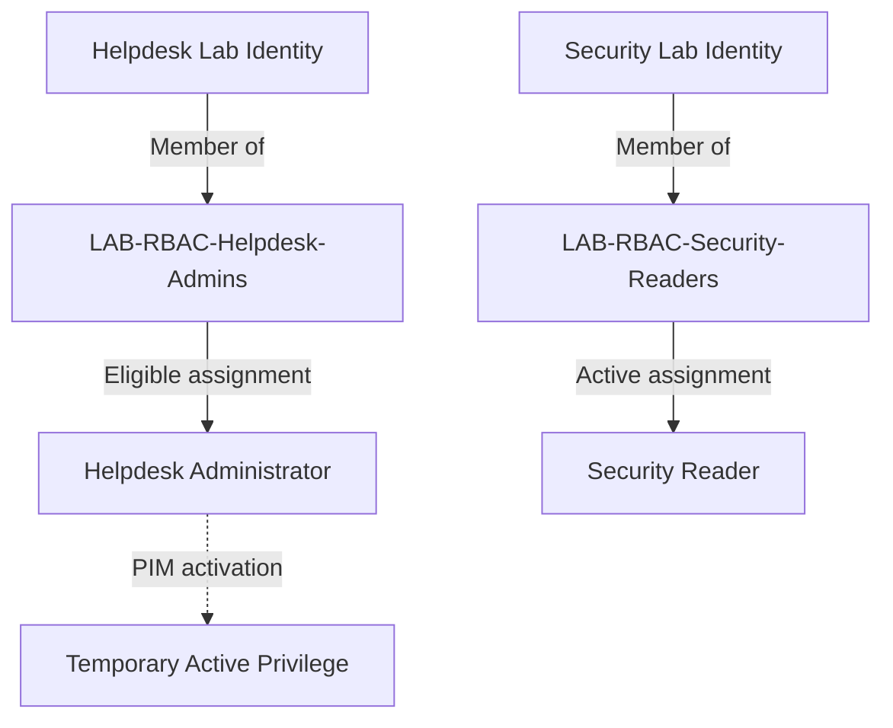
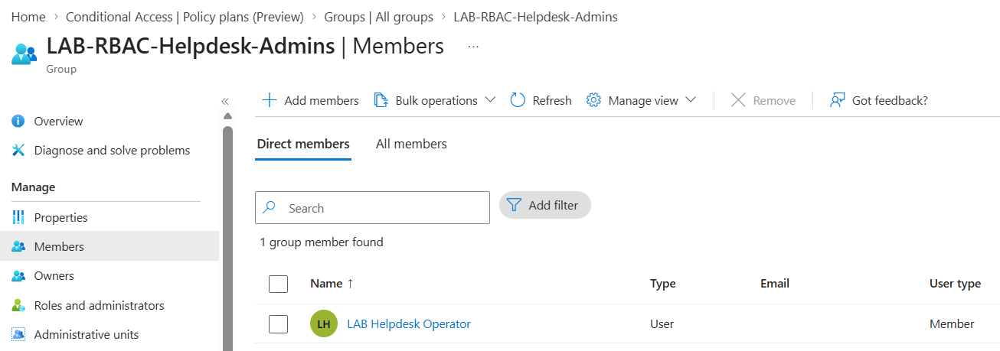
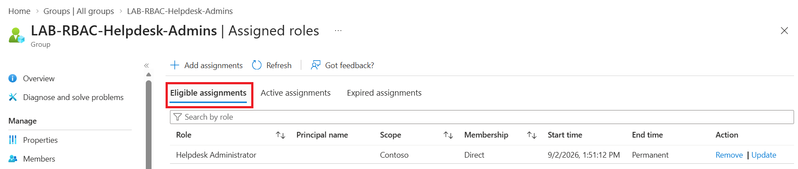
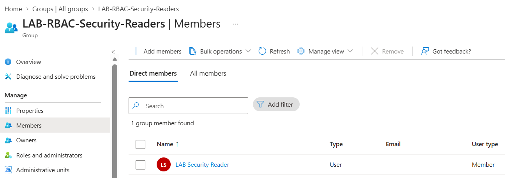
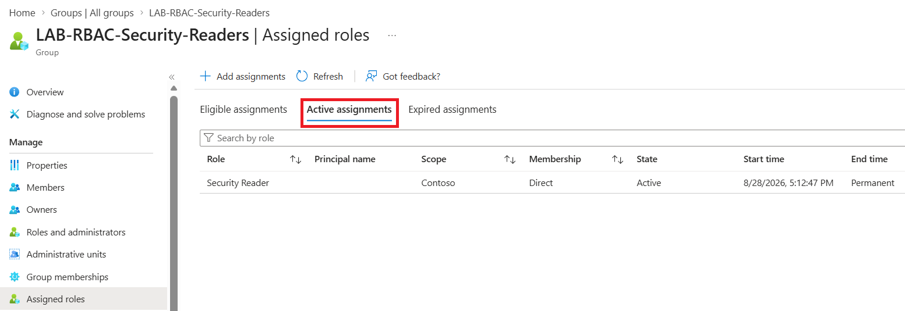

# Identity and RBAC Foundation

## Objective

Establish dedicated lab identities and role-based access control (RBAC) groups that could be used to test administrative access, least privilege, privileged elevation, and identity governance scenarios.

The Microsoft Demo Experiences tenant already contained users, groups, roles, and sample data. Rather than treating those pre-existing objects as lab implementations, I created dedicated identities and groups for specific security scenarios.

## Environment

- Microsoft Entra ID
- Microsoft Demo Experiences tenant
- Microsoft Entra administrative roles
- Role-assignable security groups

## Access Model

The lab uses dedicated security groups to represent administrative access requirements instead of assigning administrative roles directly to individual users wherever possible.

This separates four concepts:

1. **Identity** — the user requiring access
2. **Group membership** — the administrative function associated with that user
3. **Role assignment** — the Microsoft Entra administrative capability assigned to the group
4. **Privilege activation** — where applicable, Privileged Identity Management (PIM) controls when an eligible role becomes active

Two RBAC patterns are implemented in the lab:



The Helpdesk Administrator capability is **eligible rather than active by default**, requiring activation through PIM when privileged access is needed.

The Security Reader capability uses an **active assignment**, providing the group's members with the assigned read-only administrative capability without a separate activation step.

This provides two different administrative access models within the same lab environment. The detailed PIM activation workflow is documented separately in the Privileged Access section.

## RBAC Implementation and Validation

I created dedicated security groups to represent different administrative functions rather than assigning Microsoft Entra administrative roles directly to individual identities.

The implementation uses two different access patterns:

| Group | Administrative function | Microsoft Entra role | Assignment |
| --- | --- | --- | --- |
| `LAB-RBAC-Helpdesk-Admins` | Helpdesk administration | Helpdesk Administrator | Eligible |
| `LAB-RBAC-Security-Readers` | Read-only security visibility | Security Reader | Active |

Each implementation was validated by confirming both the identity's membership in the appropriate RBAC group and the role assignment associated with that group.

### Helpdesk Administrator — Eligible Access

`LAB-RBAC-Helpdesk-Admins` was created to represent identities that may require Helpdesk Administrator capabilities.

The `LAB Helpdesk Operator` identity was configured as a direct member of the group.



The group was configured with an **eligible assignment** to the Microsoft Entra **Helpdesk Administrator** role.



Together, these configurations establish the following access relationship:

```text
LAB Helpdesk Operator
        ↓
LAB-RBAC-Helpdesk-Admins
        ↓
Helpdesk Administrator (Eligible)
        ↓
PIM activation required
```

The eligibility assignment itself does not expire, but the Helpdesk Administrator privilege is not permanently active.

Group membership establishes eligibility for the administrative role. The identity must separately activate the privilege through Privileged Identity Management (PIM) when the administrative capability is required.

The PIM activation workflow, including authentication requirements, justification, approval, activation duration, and privilege expiration, is documented separately in the Privileged Access section.

---

### Security Reader — Active Access

`LAB-RBAC-Security-Readers` was created to represent identities requiring read-only security visibility.

The `LAB Security Reader` identity was configured as a direct member of the group.



The group was configured with an **active assignment** to the Microsoft Entra **Security Reader** role.



Together, these configurations establish the following access relationship:

```text
LAB Security Reader
        ↓
LAB-RBAC-Security-Readers
        ↓
Security Reader (Active)
```

Unlike the Helpdesk Administrator scenario, the Security Reader capability is active for the group and does not require a separate PIM activation step before the assigned administrative capability can be used.

### Assignment Comparison

| Identity | Group | Microsoft Entra role | Assignment | Activation |
| --- | --- | --- | --- | --- |
| `LAB Helpdesk Operator` | `LAB-RBAC-Helpdesk-Admins` | Helpdesk Administrator | Eligible | PIM activation required |
| `LAB Security Reader` | `LAB-RBAC-Security-Readers` | Security Reader | Active | No separate activation required |

The two scenarios demonstrate different group-based administrative access patterns within the same Microsoft Entra environment: **eligible privileged access** and **active read-only administrative access**.

## Lessons Learned

This exercise demonstrated the value of separating individual identities from administrative role assignments by using dedicated RBAC groups.

Rather than assigning Microsoft Entra administrative roles directly to individual users, the lab associates administrative functions with groups and manages the relevant identities through group membership.

The implementation also demonstrated two different role-assignment models:

- **Active assignment** — `LAB-RBAC-Security-Readers` provides its members with the Security Reader capability without requiring a separate activation step.
- **Eligible assignment** — `LAB-RBAC-Helpdesk-Admins` establishes eligibility for Helpdesk Administrator without keeping the privileged role continuously active.

This separation provides a useful foundation for applying different access-management approaches depending on the administrative scenario.

The Helpdesk scenario also introduced the distinction between **being eligible for privileged access** and **actively holding that privilege**. The mechanisms used to control that transition, including PIM activation, justification, approval, authentication requirements, activation duration, and privilege expiration, are documented separately in the Privileged Access section.
