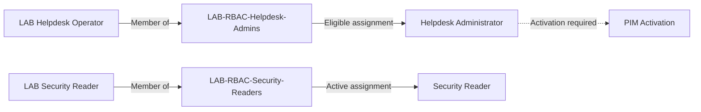

# Identity and RBAC Foundation

## Objective

Establish dedicated lab identities and role-based access control (RBAC) groups that could be used to test administrative access, least privilege, privileged elevation, and identity governance scenarios.

The Microsoft Demo Experiences tenant already contained users, groups, roles, and sample data. Rather than treating those pre-existing objects as lab implementations, I created dedicated identities and groups for specific security scenarios.

## Environment

- Microsoft Entra ID
- Microsoft Demo Experiences tenant
- Microsoft Entra administrative roles
- Role-assignable security groups

## RBAC Design, Implementation and Validation

The lab uses dedicated security groups to represent administrative functions rather than assigning Microsoft Entra administrative roles directly to individual identities wherever possible.

This separates the identity requiring access from the group representing the administrative function and the Microsoft Entra role providing the corresponding permissions.

Two different role-assignment models were implemented and validated:

| Group | Administrative function | Microsoft Entra role | Assignment |
| --- | --- | --- | --- |
| `LAB-RBAC-Helpdesk-Admins` | Helpdesk administration | Helpdesk Administrator | Eligible |
| `LAB-RBAC-Security-Readers` | Read-only security visibility | Security Reader | Active |

The resulting access model is:

The two paths demonstrate the distinction between an **eligible administrative role**, which requires a separate activation step, and an **active administrative role**, which is available through the group assignment without additional activation.

### Helpdesk Administrator — Eligible Access

`LAB-RBAC-Helpdesk-Admins` was created to represent identities that may require Helpdesk Administrator capabilities.

The `LAB Helpdesk Operator` identity was configured as a direct member of the group.

The group was configured with an **eligible assignment** to the Microsoft Entra **Helpdesk Administrator** role.

Together, these configurations establish that the `LAB Helpdesk Operator` identity becomes eligible for Helpdesk Administrator through membership in `LAB-RBAC-Helpdesk-Admins`.

Group membership does not make the Helpdesk Administrator privilege permanently active. When administrative access is required, the eligible role must be activated through Privileged Identity Management (PIM).

The PIM activation workflow, including authentication requirements, justification, approval, activation duration, and privilege expiration, is documented separately in the Privileged Access section.

### Security Reader — Active Access

`LAB-RBAC-Security-Readers` was created to represent identities requiring read-only security visibility.

The `LAB Security Reader` identity was configured as a direct member of the group.

The group was configured with an **active assignment** to the Microsoft Entra **Security Reader** role.

Together, these configurations establish that the `LAB Security Reader` identity receives the Security Reader capability through membership in `LAB-RBAC-Security-Readers`.

Unlike the Helpdesk Administrator scenario, the Security Reader capability is active for the group and does not require a separate PIM activation step.

### Assignment Comparison

| Identity | Group | Microsoft Entra role | Assignment | Activation |
| --- | --- | --- | --- | --- |
| `LAB Helpdesk Operator` | `LAB-RBAC-Helpdesk-Admins` | Helpdesk Administrator | Eligible | PIM activation required |
| `LAB Security Reader` | `LAB-RBAC-Security-Readers` | Security Reader | Active | No separate activation required |

The two scenarios demonstrate both **eligible privileged access** and **active read-only administrative access** within the same group-based RBAC design.

## Lessons Learned

This exercise demonstrated how group-based RBAC can separate individual identities from the administrative capabilities they require.

Using dedicated groups makes the access model easier to understand and manage: identities are associated with an administrative function through group membership, while Microsoft Entra roles define the permissions associated with that function.

The lab also highlighted an important distinction between **role assignment** and **privilege activation**. An identity may be eligible for an administrative role without continuously holding its privileges.

This distinction became the foundation for the next stage of the lab, where Privileged Identity Management (PIM) was used to control how and when eligible administrative access becomes active.
