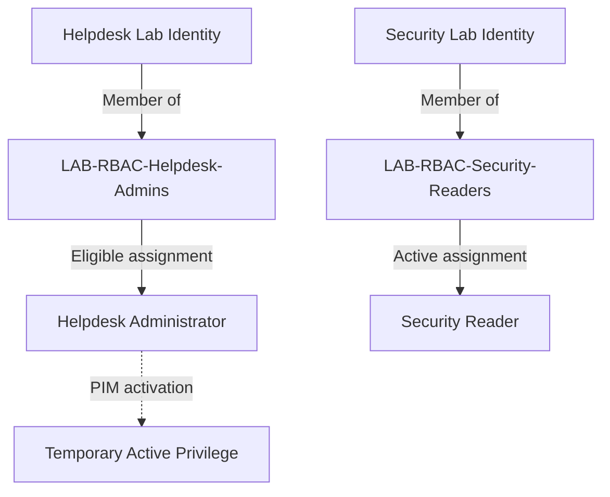

# Identity and RBAC Foundation

## Objective

Establish dedicated lab identities and role-based access control (RBAC) groups that could be used to test administrative access, least privilege, privileged elevation, and identity governance scenarios.

The Microsoft Demo Experiences tenant already contained users, groups, roles, and sample data. Rather than treating those pre-existing objects as lab implementations, I created dedicated identities and groups for specific security scenarios.

## Environment

- Microsoft Entra ID
- Microsoft Demo Experiences tenant
- Microsoft Entra administrative roles
- Role-assignable security groups

## Access Model

The lab uses dedicated security groups to represent administrative access requirements instead of assigning administrative roles directly to individual users wherever possible.

This separates four concepts:

1. **Identity** — the user requiring access
2. **Group membership** — the administrative function associated with that user
3. **Role assignment** — the Microsoft Entra administrative capability assigned to the group
4. **Privilege activation** — where applicable, Privileged Identity Management (PIM) controls when an eligible role becomes active

Two RBAC patterns are implemented in the lab:

The Helpdesk Administrator capability is **eligible rather than active by default**, requiring activation through PIM when privileged access is needed.

The Security Reader capability uses an **active assignment**, providing the group's members with the assigned read-only administrative capability without a separate activation step.

This provides two different administrative access models within the same lab environment. The detailed PIM activation workflow is documented separately in the Privileged Access section.

## Lab Identities

_To be documented and validated._

## RBAC Groups

I created dedicated security groups to represent different administrative functions within the lab.

| Group | Administrative function | Role |
| --- | --- | --- |
| `LAB-RBAC-Helpdesk-Admins` | Helpdesk administration | Helpdesk Administrator |
| `LAB-RBAC-Security-Readers` | Read-only security visibility | Security Reader |

The groups separate **membership in an administrative function** from the Microsoft Entra role that provides the corresponding permissions.

### LAB-RBAC-Helpdesk-Admins

`LAB-RBAC-Helpdesk-Admins` represents identities that may require Helpdesk Administrator capabilities.

The group is associated with the Helpdesk Administrator role through an **eligible assignment**, meaning group membership establishes eligibility for the role without making the administrative privilege permanently active.

### LAB-RBAC-Security-Readers

`LAB-RBAC-Security-Readers` represents identities requiring read-only access to Microsoft Entra security information.

The group is associated with the Security Reader role through an **active assignment**, providing the assigned administrative capability without requiring PIM activation.

Using separate groups for these functions also provided a reusable foundation for later privileged-access and governance experiments.

## Administrative Role Assignments

The two RBAC groups use different Microsoft Entra role assignment models.

### Helpdesk Administrator — Eligible Assignment

The `LAB-RBAC-Helpdesk-Admins` group was configured with an **eligible assignment** to the Microsoft Entra **Helpdesk Administrator** role.

The eligibility assignment itself has no expiration date, but this does not mean that the Helpdesk Administrator privilege is permanently active.

Instead, group members are eligible for the administrative capability and must activate the role through Privileged Identity Management (PIM) when privileged access is required.

The separate Privileged Access section documents the activation workflow, including justification, authentication requirements, administrator approval, activation duration, and privilege expiration.

### Security Reader — Active Assignment

The `LAB-RBAC-Security-Readers` group was configured with an **active assignment** to the Microsoft Entra **Security Reader** role.

The Security Reader assignment is active and does not require a separate PIM activation before the group's assigned administrative capability can be used.

### Assignment Comparison

| Group | Microsoft Entra role | Assignment type | Activation required |
| --- | --- | --- | --- |
| `LAB-RBAC-Helpdesk-Admins` | Helpdesk Administrator | Eligible | Yes, through PIM |
| `LAB-RBAC-Security-Readers` | Security Reader | Active | No |

The lab therefore demonstrates both persistent group-based administrative access and eligible privileged access within the same RBAC model.

## Validation

_To be documented._

## Lessons Learned

_To be documented._
